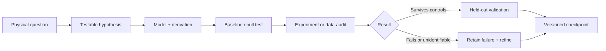

# Dark Sector Atlas
**An open research notebook on the invisible universe.**

*Physics → falsifiable hypotheses → mathematics → measurements → reproducible tests.*

This repository is a **living research record**, not a claim that dark matter has been detected or a journal-reviewed paper. It preserves derivations, failed approaches, simulated experiments, observational source audits and the questions that survive them.

> **Start here:** [Explore the atlas](ATLAS.md) · [Current research state](checkpoints/RESEARCH_STATE.md) · [Learn the mathematics](learning/README.md) · [Hypothesis ledger](hypotheses/README.md)

## The research map

| Physics area | The physical question | Research path |
|:--|:--|:--|
| **Astrophysics · Self-interacting dark matter** | Can particle collisions inside halos explain collapse, and can lensing distinguish it from ordinary substructure? | [SIDM and lensing](research/README.md#sidm-and-gravitational-lensing) |
| **Condensed matter · Quantum detection** | Can anisotropic materials reveal directional scattering above real instrumental backgrounds? | [Detector materials](research/README.md#directional-detectors-and-materials) |
| **Cosmology · Initial conditions** | Did small-scale structure originate differently, or evolve differently? | [Cosmological degeneracies](research/README.md#cosmological-initial-conditions) |
| **Particle astrophysics · Neutrinos** | Can missing host catalogs, source physics and detector response imitate novel propagation? | [Neutrino inference](research/README.md#neutrino-inference) |

### Readable first. Auditable always.

Each study should have a **one-minute explanation** followed by the exact claim, mathematical derivation, assumptions, reproducing commands and provenance. Captions must say whether a figure shows **OBSERVED DATA**, **SIMULATED DATA**, **MODEL FORECAST** or an **EXPLANATORY DIAGRAM**. An illustrative plot is not a discovery.

**Research status labels:** `DERIVED` · `SIMULATION_RESULT` · `BASELINE_REPRODUCED` · `FORECAST` · `CONJECTURE` · `UNIDENTIFIABLE` · `DATA_INSUFFICIENT` · `FAILED` · `NO_ADVANCE`.

### Latest verified archive state

The repository's initial structure is being organized. Earlier ChatGPT reports described calculations through **14 October 2026**, but **the underlying run archives and scripts have not yet been imported and independently checked inside this repository**. Those reports are continuity leads, not automatically reproduced results. See [research checkpoint](checkpoints/RESEARCH_STATE.md).

## Publishing and attribution

This public repository is a research log. Posting code here does **not** submit a paper, establish author affiliation, certify novelty or grant permission to redistribute third-party materials. A release candidate must pass source, license, reproducibility, statistical and human-review checks in [Publication readiness](publication/READINESS.md).

**Navigation:** [Atlas](ATLAS.md) / [Studies](research/README.md) / [Hypotheses](hypotheses/README.md) / [Figures](figures/README.md) / [Sources](sources/README.md) / [Methods](methods/README.md) / [Learning](learning/README.md).
