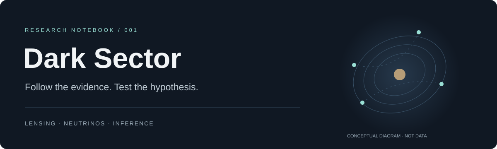

<p align="center"></p>

<p align="center"><strong>A living notebook for the physics we can test.</strong><br>Dark matter · gravitational lensing · neutrino inference</p>

<p align="center"><a href="research/STATUS.md">Research state</a> · <a href="research/HYPOTHESES.md">Hypotheses</a> · <a href="docs/REPRODUCIBILITY.md">Run the audit</a> · <a href="docs/SOURCES.md">Sources</a></p>

---

## The question

**When does an unusual observation require new dark-sector physics, and when can ordinary astrophysics or measurement uncertainty explain it?**

This repository tracks mathematics, controlled experiments, competing explanations, and missing evidence. It is an evolving research and learning notebook, with AI-assisted preparation and explicit verification boundaries.

## Where we stand · 14 October 2026

**JWST lensing:** six attributed narrow-line ratios from RXJ1131-1231 and a locally checked algebraic audit. The joint flux posterior, warm-dust uncertainties, and lens-model posterior are still needed.

**Neutrino inference:** recovered summaries of catalog/background and detector-coordinate toy studies. Original archives and an independently reproduced IceTracks-DR2-v2 baseline are still needed.

**Directional detectors:** a historical mention of a synthetic modulation study. Its methods and material-specific sensitivity evidence remain missing.

**No new dark particle, SIDM cross-section, or observational Bayes factor has been established here.** The 29-quasar inference remains a [result reported by its authors](https://arxiv.org/abs/2609.35974v1), not a result reproduced by this repository.

## Latest checkpoint

### Six ratios. Three independent log contrasts.

Four image fluxes yield six pairwise comparisons, but the common brightness scale cancels. Their exact logarithmic contrasts have rank three.

For the rounded [published narrow-line values](https://arxiv.org/html/2606.23808v1#S4.T2):

$$
\frac{F_C}{F_B}=\frac{F_C/F_A}{F_B/F_A}=\frac{0.35}{0.45}\approx0.77778.
$$

That agrees with the reported $0.78$ at its displayed precision. This is a consistency check, not a lens-model test. Marginal error bars alone do not supply the joint likelihood.

**Next useful action:** recover the joint flux posterior, then test competing host and halo models against independent observables. [Read the checkpoint →](research/checkpoints/2026-10-14.md)

## Reproduce one bounded result

Python 3.11+ and NumPy are sufficient. No telescope files, credentials, or paid service are needed.

```sh
python3 -m venv .venv
. .venv/bin/activate
python -m pip install -r requirements.txt
python -m unittest discover -s tests -v
python experiments/ratio_closure/run.py --output /tmp/dark-sector-ratio-audit.json
python experiments/ratio_closure/run.py --check
```

This runs new code written for this repository. It checks published **rounded summary values** and an explicitly **illustrative** covariance. It does not recover the original ChatGPT code or rerun the spectral fit. [Inputs, tolerances, and proof boundaries →](docs/REPRODUCIBILITY.md)

## Explore the notebook

| Start here | Purpose |
| :--- | :--- |
| [Research state](research/STATUS.md) | Available evidence, blockers, and the next gate |
| [Hypothesis tracker](research/HYPOTHESES.md) | Predictions, conventional alternatives, and rejection criteria |
| [Research checkpoints](research/checkpoints/README.md) | Dated progress with reported and verified results separated |
| [Methods](research/methods/README.md) | Derivations, assumptions, and limiting cases |
| [Learning checkpoints](research/LEARNING.md) | Concepts introduced and exercises to assess understanding |
| [Recovery inventory](docs/RECOVERY.md) | What was recovered, reconstructed, and remains missing |
| [Sources](docs/SOURCES.md) | Primary references and their roles |

## How progress becomes a version

Each update should answer one question, preserve its inputs, record its run, and state what would falsify its interpretation. Changes go through a branch and PR before joining the main notebook. [Update procedure and templates →](CONTRIBUTING.md)

The existing **daily morning Singapore research schedule is unchanged**. This repository does not create or replace a scheduler. Automatic delivery of future morning outputs into GitHub has not been verified; the [handoff procedure](docs/CONTINUITY.md) explains how to turn each output into a reviewable update.

---

<p align="center"><sub>Evidence before interpretation. Reproducibility before confidence.</sub></p>
