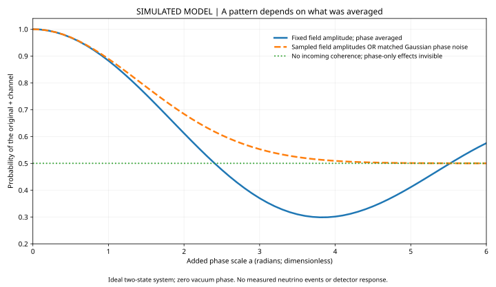

# Neutrino phases: which signature survives averaging?

**N-03 · v1.0.0 · 14 October 2026**  
**Physics:** quantum mechanics, particle astrophysics, ultralight dark fields.  
**Status:** `DERIVED` + `SIMULATION_RESULT`; origin of matched phase noise `UNIDENTIFIABLE` from the specified averaged probabilities alone.

[Worked derivation](METHODS_RESULTS_v1.0.md) · [Executable audit](run.py) · [Results](output/results.json) · [Checkpoint](CHECKPOINT.md) · [Research home](../../research/STATUS.md)



**One-minute result:** a fixed-amplitude oscillating perturbation and an amplitude-fluctuating perturbation need not produce the same averaged interference pattern. Sampling Rayleigh-distributed amplitudes produces exactly the same averaged probabilities as matched ordinary Gaussian phase noise. A recognizable curve is not a unique particle identification.

Every curve is a deterministic **SIMULATED MODEL** expectation. No observed neutrino counts, detector response or physical coupling constraint is included. The horizontal coordinate is added phase scale, not neutrino energy or dark-matter mass. The vacuum phase is set to zero for this display.

## Reproduce

From this folder, with the dependencies below available:

```sh
python run.py --output output
python plot.py
```

Tested: Python 3.13.5, NumPy 2.3.5, SciPy 1.17.0; plotting uses Matplotlib. No packages were installed for this run. Exact environment and hashes are recorded. Numerical tolerances, not byte-identical wall times, define reproducibility. The CSV contains 61 parameter-grid evaluations, not 61 independent observations.

One successful process completed in 3.876 seconds including startup after an output-permission failure. Twelve checks passed. The missing predecessor was **not** recovered or reproduced. The stored SVG is a compact rendering of saved values; plot.py regenerates a full vector and 2500-pixel PNG.
